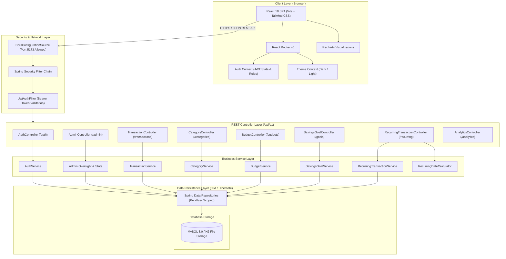
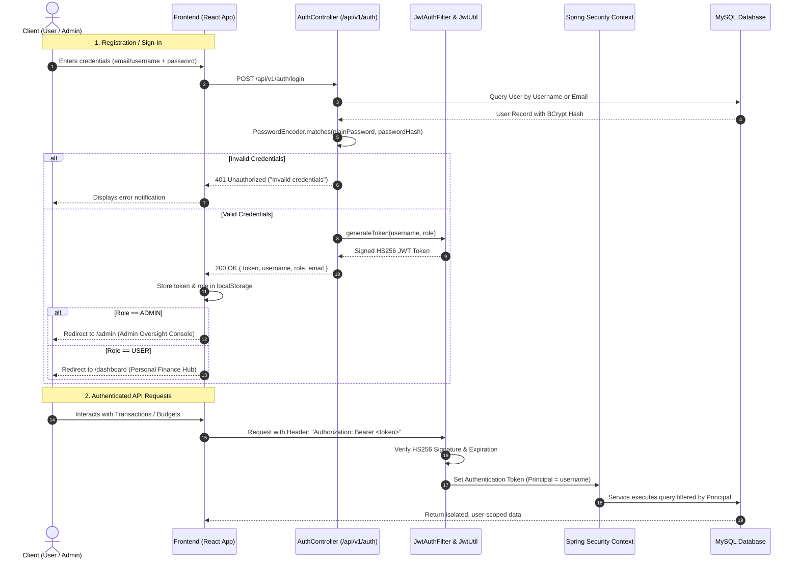
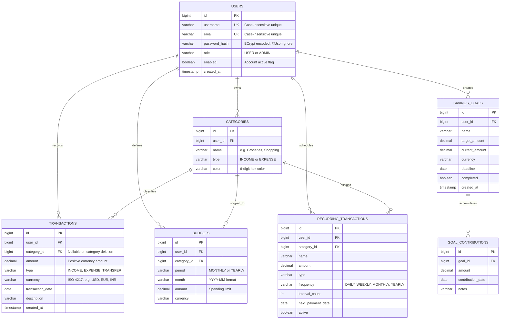

# Spendwise — Smart Financial Management & Analytics Platform

[](https://spring.io/projects/spring-boot)
[](https://openjdk.org/)
[](https://react.dev/)
[](https://vitejs.dev/)
[](https://tailwindcss.com/)
[](https://www.mysql.com/)
[](#testing--verification)

**Spendwise** is an enterprise-grade personal finance and expenditure intelligence web application. It combines deep expense tracking, dynamic budgeting, automated recurring payment schedules, interactive savings goal ledgers, financial calculators, and a restricted **Master Administrator Console** with complete user dossier inspection and platform oversight.

---

## 🏛️ System Architecture



---

## 🔄 User Authentication & Navigation Lifecycle



---

## 📊 Entity Relationship Diagram (ERD)



---

## 🚀 Key Features

### 1. 💳 Intelligent Transaction Engine
- **Preset Categories & Quick Chips**: One-click quick adds for **Groceries 🛒**, **Shopping 🛍️**, **Dining & Food 🍔**, **Transportation 🚗**, **Bills & Utilities ⚡**, **Salary 💼**, **Investments 📈**, and more.
- **Advanced Filtering**: Full-text keyword search, type filter (`INCOME`, `EXPENSE`, `TRANSFER`), currency selection, date-range picker, and custom sorting (`amount`, `transactionDate`, `createdAt`).
- **CSV Data Export**: Secure CSV export with formula injection sanitization.

### 2. 🛡️ Master Administrator Console (`/admin`)
- **Restricted Access Portal**: Clean, dedicated administrator login page (`/admin/login`) with no registration link and interactive password visibility toggle.
- **Platform Analytics**: Real-time aggregate telemetry of total users, total transactions, system volume, active budgets, and savings goals.
- **Deep User Dossiers**: Interactive modal to inspect individual user profiles, creation dates, enabled/disabled status, and associated records.
- **User Moderation**: Immediate account enable/disable suspension toggle and deletion safety controls.

### 3. 🧮 Comprehensive Financial Calculators Suite
- **SIP (Systematic Investment Plan) Calculator**: Compound returns, total wealth accumulation, and invested vs. earned breakdown.
- **Loan EMI Calculator**: Monthly installment calculation, total interest payable, and amortization schedule summary.
- **Compound Interest Calculator**: Compounding frequency modeling (monthly, quarterly, annually) with inflation adjustment.
- **Emergency Fund Planner**: Calculates essential survival safety net based on monthly expenses and dependency buffers.
- **Retirement Wealth Planner**: Future value of retirement nest-egg factoring annual savings, expected ROI, and years to retirement.

### 4. 📊 Visual Analytics & Reports
- **Cash Flow Trends**: Interactive bar and area charts powered by **Recharts** displaying monthly Income vs. Expense trajectories.
- **Category Spending Distribution**: Responsive donut charts visualizing expenditure proportions with custom category color palettes.
- **Budget Health Tracking**: Real-time spending progress bars warning when spending approaches 80% or exceeds 100% of limits.

### 5. 🎯 Savings Goals & Ledgers
- Set milestone targets with deadlines and target amounts.
- Atomic contribution transactions with automated status transitions (`completed = true` upon reaching 100%).

### 6. 🔁 Recurring Subscriptions & Schedules
- Automatic interval calculators for daily, weekly, monthly, and yearly recurring obligations.
- One-click advance payment progression and active/paused state toggling.

### 7. 🎨 UI/UX Excellence & Theming
- **Dual Theme Support**: Persistent Dark & Light modes with smooth transitions.
- **Eye Password Toggle**: Accessible show/hide visibility toggles on both user and administrator authentication pages.
- **Currency Flexibility**: Multi-currency support across USD ($), EUR (€), GBP (£), INR (₹), JPY (¥), CAD ($), and AUD ($).

---

## 🛠️ Technology Stack

| Domain | Technology | Purpose |
|---|---|---|
| **Backend Framework** | **Spring Boot 3.3.4** | Robust REST API microservice architecture |
| **Language** | **Java 25 (LTS)** | Strongly typed, high-performance runtime |
| **Security** | **Spring Security 6 + JJWT** | Stateless HS256 JWT authentication & role-based authorization |
| **ORM / Persistence** | **Spring Data JPA & Hibernate 6** | Declarative repositories, atomic transactions, schema validation |
| **Migration** | **Flyway** | Versioned database migrations |
| **Database** | **MySQL 8.0 & H2 Database** | Production MySQL persistence with zero-config H2 file fallback |
| **Frontend Framework**| **React 18.3** | Component-driven reactive user interface |
| **Build Tool** | **Vite 5.4** | Ultra-fast HMR and optimized production bundling |
| **Styling** | **Tailwind CSS 3.4** | Modern utility-first responsive styling |
| **Visualization** | **Recharts 2.12** | Declarative, SVG-based responsive financial charts |
| **Routing** | **React Router DOM 6.26** | Single-page application route management & protected route guards |

---

## ⚙️ Local Development & Setup

### Prerequisites
- **JDK 17+** (JDK 25 recommended)
- **Node.js 18+** & `npm`
- **Maven 3.8+**
- **MySQL 8.0** (optional; the app runs automatically with embedded persistent file storage)

### 1. Environment Configuration

Copy the example environment template:
```powershell
Copy-Item .env.example .env
```

Default environment variables:
```properties
DB_URL=jdbc:mysql://localhost:3306/spendwise?useSSL=false&serverTimezone=UTC
DB_USER=root
DB_PASSWORD=your_mysql_password
JWT_SECRET=c3BlbmR3aXNlLXNlY3VyZS1qd3Qta2V5LWF0LWxlYXN0LTMyLWNoYXJzIQ==
JWT_EXPIRATION_MS=86400000
FRONTEND_URL=http://localhost:5173
```

### 2. Running the Backend

```powershell
cd backend
mvn spring-boot:run "-Dspring-boot.run.profiles=h2"
```
*The backend starts at `http://localhost:8080` with API endpoints accessible under `/api/v1`.*

### 3. Running the Frontend

```powershell
cd frontend
npm install
npm run dev
```
*The frontend starts at `http://localhost:5173`.*

---

## 🧪 Testing & Verification

The project includes automated test coverage for core business logic, transaction calculations, and export formatting:

```powershell
# Backend test suite (21 unit & integration tests)
cd backend
mvn clean test

# Frontend linting & build verification
cd frontend
npm run lint
npm run build
```

**Verification Results:**
- ✅ **Backend Compilation**: `BUILD SUCCESS` (62 files, 0 errors, 0 warnings).
- ✅ **Backend Unit Tests**: 21 / 21 tests passed (0 failures, 0 errors).
- ✅ **Frontend Lint**: 0 warnings, 0 errors.
- ✅ **Frontend Production Bundle**: Built cleanly in 2.03s.

---

## 🔒 Security Model

- **Credential Isolation**: User passwords are encrypted using **BCrypt** with salted hashing. User password hashes are annotated with `@JsonIgnore` and never serialized across API responses.
- **Tenant Isolation**: Every database query explicitly checks the authenticated principal (`user.username`). No endpoint permits passing arbitrary user IDs to access private transactions.
- **Formula Injection Mitigation**: CSV export outputs escape leading symbols (`=`, `+`, `-`, `@`) with apostrophes to protect against spreadsheet formula execution vulnerabilities.
- **CORS Protection**: Restricted to the configured `FRONTEND_URL` with explicit methods and allowed headers.

---

## 📄 License
This project is licensed under the MIT License.
